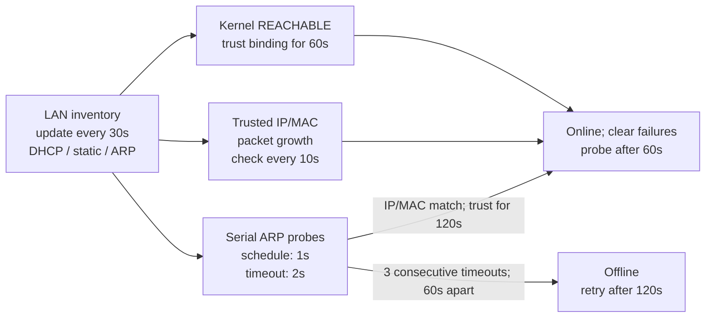

# luci-theme-unifi

[简体中文](docs/README.md) · [Installation](#installation) · [Development](docs/development.md)

A UniFi-inspired theme for OpenWrt and ImmortalWrt, with a live dashboard, client inventory, and light and dark modes.

## Preview

<p>
  <a href="docs/images/dashboard-en.png"></a>
</p>

<p>
  <a href="docs/images/clients-dark-en.png"></a>
</p>

<p>
  <a href="docs/images/login-en.png"></a>
</p>

## Features

- **Dashboard** — interface traffic, CPU, memory, uptime, and network status; optional background sampling with one hour of in-memory history.
- **Client devices** — search, filters, device details, configurable columns, and CSV export, with offline vendor hints.
- **Light and dark** — follow your system or switch manually, with layouts for desktop and mobile.
- **LuCI integration** — compact navigation, a dedicated login page, and built-in theme settings. Native configuration pages and authentication stay available.

## Compatibility

**Tested on the 23.05 series** (ImmortalWrt 23.05.4). **Newer versions have not been tested.** Requires LuCI with ucode templates and the `opkg` package manager.

Dependencies: `luci-base`, `luci-theme-bootstrap`, `luci-mod-status`, `ucode-mod-uloop`, `iputils-arping`. The package manager installs these from your firmware's feeds.

## Installation

1. Download `luci-theme-unifi_…_all.ipk` from [Releases](https://github.com/mouse233/luci-theme-unifi/releases). For a development build, open a successful [Actions → CI](https://github.com/mouse233/luci-theme-unifi/actions/workflows/ci.yml) run, download its `luci-theme-unifi-…` artifact, and extract the IPK.
2. Upload the IPK to the router's `/tmp/` directory.
3. Run over SSH on the router:

```sh
opkg update
opkg install /tmp/luci-theme-unifi_*.ipk
```

In **System → System → Language and Style**, select **Unifi**, then save and apply. Installation itself does not switch your active theme.

Open **System → Unifi Theme Settings** to adjust appearance, refresh intervals, pagination, and navigation. **Always sample network activity** is enabled by default and keeps collecting while the dashboard is closed; history stays in memory and clears when the collector or router restarts.

**Upgrading:** switch to another theme before installing the replacement package, then select Unifi again. Settings in `/etc/config/unifi` are preserved during normal upgrades.

**Uninstalling:** select another theme first, then run:

```sh
opkg remove luci-theme-unifi
```

For backup and SSH recovery instructions, see the [development guide](docs/development.md#restore-or-uninstall).

## How client presence is detected

The background service combines the following evidence for IPv4 devices on a single LAN:



Devices start as unknown; leases or retained ARP entries alone do not prove liveness. Conflicting bindings are excluded, and command errors do not count as probe timeouts. Probe queues and new positive evidence can delay an offline decision.

## Measured resource overhead

Measured with **Intel N100 (QEMU VM, 4 vCPUs), ImmortalWrt 23.05.4**: three minutes of live network activity, about 1,500–2,500 connections and 33 tracked devices.

| Background task | Average CPU use, one core |
| --- | --- |
| Network activity sampling, once per second | **0.09%** |
| Client presence detection | **0.96%** |

100% means one fully occupied CPU core. Together, the two tasks used about **0.26% of total four-core capacity**; actual usage varies with device and connection counts.

Large JS assets were also measured: **10 runs with browser cache disabled**, downloaded from the router using **Apple M1 / Chrome 157**. Responses were uncompressed; the table shows medians for resource loading, excluding the rest of the page.

| Asset | Size | Download + read text | Browser parsing/compilation |
| --- | --- | --- | --- |
| `vendor-data.js` | ~1.30 MB | **55.6 ms** | **6.6 ms** |
| `icon-data.js` | ~239 kB | **10.8 ms** | **0.8 ms** |

Browser parsing/compilation was measured on the Apple M1 client. Mobile browsers and complete first-page loading remain untested.

## Local preview and development

Preview the theme without a router, using Python 3.9+:

```sh
python3 tools/preview_server.py
```

Open [127.0.0.1:8765](http://127.0.0.1:8765/). The preview uses synthetic data and does not connect to your router.

See the [development guide](docs/development.md) for local packaging, SDK builds, tests, and tag releases, and the [changelog](CHANGELOG.md) for version history. When [reporting an issue](https://github.com/mouse233/luci-theme-unifi/issues/new/choose), provide your OpenWrt firmware version, describe the problem, and include screenshots if applicable.

## License and credits

Original code is licensed under [Apache-2.0](LICENSE). Thanks to LuCI Bootstrap, Inter, Simple Icons, and the IEEE Registration Authority for templates, fonts, icons, and MAC prefix data.

Third-party assets retain their own terms: [Inter / OFL](htdocs/luci-static/unifi/fonts/LICENSE.txt), [Simple Icons / CC0](root/usr/share/licenses/luci-theme-unifi/Simple-Icons-CC0.txt), and the [UniFi wordmark rights notice](htdocs/luci-static/unifi/login-wordmark.NOTICE).

UniFi is a trademark of Ubiquiti Inc. This is an independent community theme, unaffiliated with Ubiquiti, OpenWrt, or ImmortalWrt.
