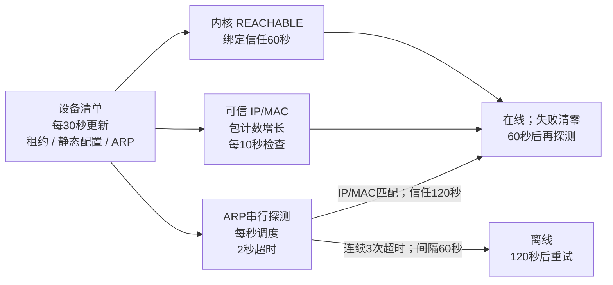

# luci-theme-unifi

[English](../README.md) · [安装](#安装) · [开发指南](development.zh-CN.md)

为 OpenWrt 和 ImmortalWrt 制作的 UniFi 风格主题，提供实时仪表盘、客户端列表和浅深色模式。

## 预览

<p>
  <a href="images/dashboard.png"></a>
</p>

<p>
  <a href="images/clients-dark.png"></a>
</p>

<p>
  <a href="images/login.png"></a>
</p>

## 功能

- **仪表盘**：查看接口流量、CPU、内存、运行时间和网络状态，可选后台采样，在内存中保留最近 1 小时的记录。
- **客户端设备**：支持搜索、筛选、设备详情、自定义列及 CSV 导出，内置离线厂商识别提示。
- **浅深色外观**：跟随系统或手动切换，适配桌面和手机。
- **LuCI 集成**：紧凑导航栏、独立登录页和内置主题设置，保留原生配置页面与认证流程。

## 兼容性

**23.05 系列已测试通过**（实测 ImmortalWrt 23.05.4），**更高版本待测试**。需要使用 ucode 模板的 LuCI 和 `opkg` 包管理器。

依赖：`luci-base`、`luci-theme-bootstrap`、`luci-mod-status`、`ucode-mod-uloop`、`iputils-arping`，安装时由包管理器从固件软件源获取。

## 安装

1. 从 [Releases](https://github.com/mouse233/luci-theme-unifi/releases) 下载发布版本的 `luci-theme-unifi_…_all.ipk`。开发版可在 [Actions → CI](https://github.com/mouse233/luci-theme-unifi/actions/workflows/ci.yml) 的成功运行中下载 `luci-theme-unifi-…` artifact，解压后取出 IPK。
2. 将 IPK 上传至路由器 `/tmp/`。
3. 通过 SSH 在路由器上执行：

```sh
opkg update
opkg install /tmp/luci-theme-unifi_*.ipk
```

在 **系统 → 系统 → 语言和界面** 中选择 **Unifi**，保存并应用。安装主题不会自动切换当前外观。

在 **系统 → Unifi 主题设置** 中调整外观、刷新间隔、分页和导航栏。“总是采样网络活动”默认开启，关闭仪表盘仍会采集；历史仅保存在内存中，路由器或采集服务重启后清空。

**升级**：先切换到其他主题，再安装新版本，完成后重新选择 Unifi。正常升级会保留 `/etc/config/unifi` 中的设置。

**卸载**：先切换到其他主题，再执行：

```sh
opkg remove luci-theme-unifi
```

备份及通过 SSH 恢复主题的方法见[开发指南](development.zh-CN.md#恢复与卸载)。

## 客户端在线探测原理

后台结合以下证据判断状态，仅覆盖单个 LAN 的 IPv4 设备：



设备初始状态为未知；租约或历史 ARP 记录本身不代表在线。地址绑定冲突会排除设备，命令执行错误不计为探测超时。探测排队和新的在线证据会影响实际判离线时间。

## 性能开销实测

在 **Intel N100（QEMU 虚拟机，4 个 vCPU）、ImmortalWrt 23.05.4** 上连续实测 3 分钟，期间约有 1,500–2,500 条连接、33 台被跟踪设备。

| 后台任务 | 单核平均 CPU 占用 |
| --- | --- |
| 网络活动采样（每秒一次） | **0.09%** |
| 客户端在线检测 | **0.96%** |

100% 表示占满一个 CPU 核心。两项合计约占**四核总算力的 0.26%**；实际开销会随设备和连接数变化。

大 JS 资源也进行了测量：使用 **Apple M1 / Chrome 157** 从路由器下载，**禁用浏览器缓存，共测10次**。响应均未压缩，下表为资源加载耗时的中位数，不包含其余页面加载。

| 资源 | 大小 | 下载并读取文本 | 浏览器解析／编译 |
| --- | --- | --- | --- |
| `vendor-data.js` | 约1.30 MB | **55.6 毫秒** | **6.6 毫秒** |
| `icon-data.js` | 约239 kB | **10.8 毫秒** | **0.8 毫秒** |

解析／编译发生在 Apple M1 客户端浏览器上；手机浏览器和完整首次页面加载尚未测量。

## 本地预览与开发

无需路由器，使用 Python 3.9+ 即可预览：

```sh
python3 tools/preview_server.py
```

打开 [127.0.0.1:8765](http://127.0.0.1:8765/)。预览使用虚构数据，不连接路由器。

本地打包、SDK 构建、测试及标签发布见[开发指南](development.zh-CN.md)，版本变更见[更新日志](../CHANGELOG.md)。[反馈问题](https://github.com/mouse233/luci-theme-unifi/issues/new/choose)时，请提供 OpenWrt 固件版本、描述问题表现，并按需附上截图。

## 许可与致谢

原创代码采用 [Apache-2.0](../LICENSE) 许可。感谢 LuCI Bootstrap、Inter、Simple Icons 和 IEEE Registration Authority 提供模板、字体、图标及 MAC 前缀数据。

第三方素材保留各自的许可与权利：[Inter / OFL](../htdocs/luci-static/unifi/fonts/LICENSE.txt)、[Simple Icons / CC0](../root/usr/share/licenses/luci-theme-unifi/Simple-Icons-CC0.txt)、[UniFi 字标权利说明](../htdocs/luci-static/unifi/login-wordmark.NOTICE)。

UniFi 为 Ubiquiti Inc. 的商标。本项目为独立社区主题，与 Ubiquiti、OpenWrt 或 ImmortalWrt 无隶属关系。
